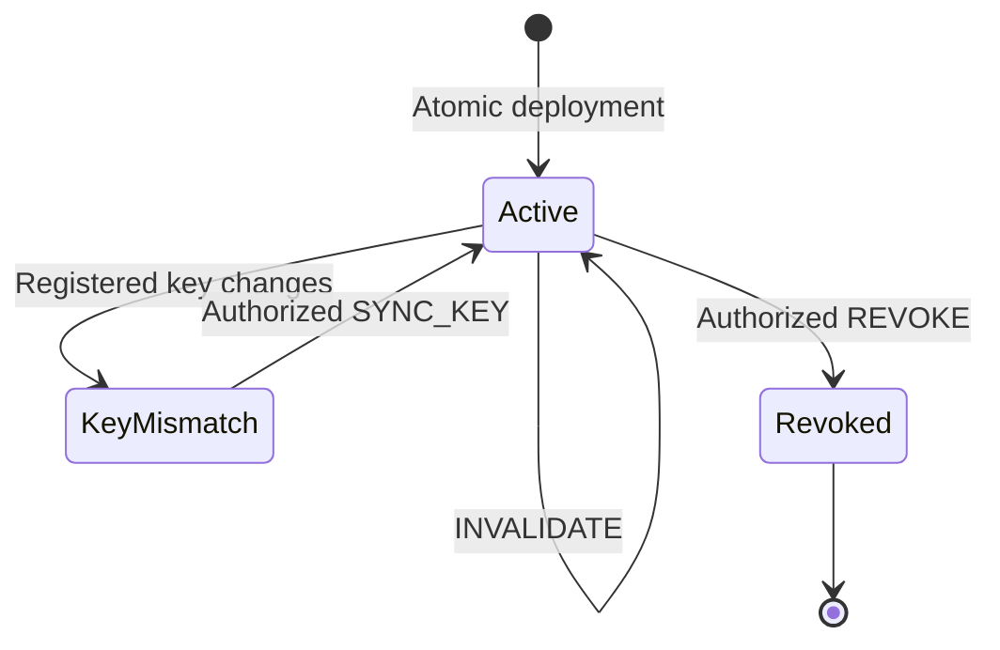

# Post-Quantum Authorization

**Protocol:** Vigiver Authorization v1

**Status:** Proposed implementation specification

## 1. Purpose

The authorization component protects supported sensitive blockchain
operations against modification, replay, unauthorized execution
and conventional-key compromise.

It is a security boundary within Vigiver's broader investigation
and mitigation workflow.

Its purpose is not to replace existing wallets, invent cryptographic
algorithms, or provide unrestricted account recovery.

The first implementation targets QoreChain Diana and its native
ML-DSA-87 verification and registered-key capabilities.

## 2. Initial security scenario

An existing contract depends on a conventional administrative key.

The agent investigates the contract and identifies whether its
administrative authority can be transferred to a protected
controller.

If the existing authority remains available, an authorized transfer
can establish the controller as the new administrator.

Subsequent supported administrative operations require an exact
post-quantum authorization.

The initial authority transfer still depends on the target's
existing authorization rules.

Vigiver cannot guarantee protection against an attacker who has
already taken control of that authority.

The controller protects only operations that are actually routed
through its enforced authorization boundary.

Alternative roles, proxy administrators, emergency permissions
and other bypasses must be investigated separately.

## 3. Threat model

| Threat | Required protection |
|---|---|
| Compromised classical executor | Cannot fabricate or modify a valid PQC authorization. |
| Malicious agent proposal | Cannot bypass deterministic policy or on-chain authorization. |
| Copied authorization | Cannot be submitted by a different executor. |
| Replayed authorization | Cannot produce a second successful execution. |
| Modified arguments | Must invalidate the authorization. |
| Obsolete policy | Must invalidate authorizations from earlier epochs. |
| Stale target state | Must prevent execution against incompatible preconditions. |
| Unregistered or substituted key | Must not satisfy authority validation. |
| Malformed verification response | Must fail closed. |
| Reentrant target | Must not reuse or bypass an authorization. |
| Compromised RPC | Must not substitute the controller's on-chain authority key. |

The threat model assumes the applicable ML-DSA-87 implementation,
network execution rules and controller implementation satisfy
their required security properties.

An attacker who controls all credentials required by the active
policy may produce an otherwise valid authorization.

The protocol does not guarantee recovery from complete
authority failure, chain compromise or arbitrary immutable
contract vulnerabilities.

## 4. Participants

| Participant | Responsibility |
|---|---|
| Agent | Investigates and prepares attributable proposals. |
| User | Reviews and approves operations. |
| Authority | Holds the recognized native PQC signing capability. |
| Executor | Submits the authorized transaction. |
| Controller | Enforces application authorization. |
| Target | Implements the supported administrative operation. |

Agent attribution is distinct from signing authority.

The authority is distinct from the EVM transaction executor.

The executor may be selected separately for each authorization.

The executor does not acquire administrative authority by
submitting a transaction.

Concordium identity verification is initially performed at the
application boundary. No native cross-chain identity verifier is
assumed to exist inside the QoreChain controller.

## 5. Cryptographic boundary

### 5.1 Native verification

| Precompile | Address |
|---|---|
| PQC verification | 0x0000000000000000000000000000000000000a01 |
| Registered-key status | 0x0000000000000000000000000000000000000a02 |

Verification ABI:

`pqcVerify(bytes,bytes,bytes)(bool)`

Registered-key status ABI:

`pqcKeyStatus(address)(bool,uint8,bytes,bool)`

The existing `QorePqcVerifier` library provides the cryptographic
signature verification boundary.

Registered-key validation is a separate responsibility.

The initial supported algorithm is ML-DSA-87, algorithm ID `1`.

Required sizes:

- Public key: 2592 bytes.
- Signature: 4627 bytes.

A required precompile call that fails, returns empty data,
or returns a malformed or unsupported response must cause
authorization failure.

### 5.2 Recognized authority

The controller stores a native authority represented by its
20-byte account address.

This representation must correspond to the intended native
QoreChain account.

It is not inferred from the wallet's separate Ethereum address.

For ordinary protected operations, the controller retrieves the
current registered key and requires:

1. Registration is present.
2. The algorithm is supported.
3. Proof of possession is affirmative.
4. The public key encoding and length are valid.
5. SHA-256 of the registered key equals the admitted commitment.
6. The authorization refers to that same commitment.

The caller does not supply the trusted verification key.

### 5.3 Signing scheme

The tested QoreX `signArbitrary` method produces a hybrid
message signature.

The PQC signing input is:

```text
UTF8("qorechain-msg-v1|" + nativeChainId + "|")
||
canonicalAuthorizationMessage
```

For Diana, the native chain identifier is:

`qorechain-diana`

The ML-DSA context is empty.

The controller reconstructs these exact bytes and verifies
the ML-DSA-87 signature through the native precompile.

The application validates the returned hybrid signature format
and its relationship to the selected signing authority.

Classical ADR-36 verification is part of full off-chain hybrid
signature verification.

The initial on-chain application policy specifically requires
ML-DSA-87 authorization and does not claim to implement
full QoreSign hybrid verification inside Solidity.

The native transaction sender's signature is a separate
transaction-admission requirement.

## 6. Controller scope

The initial controller protects one explicitly configured target.

The first target is a directly deployed, non-proxy test contract
with transferable ownership and a typed administrative operation.

The initial target interface is conceptually:

```solidity
function owner() external view returns (address);
function parameter() external view returns (uint256);
function setParameter(uint256 newValue) external;
```

The target must reject direct administrative calls from accounts
that are not its recognized owner.

The controller will not expose arbitrary call execution,
delegatecall, token approval or unrestricted asset transfers.

The initial controller supports the following operations:

| Action | ID | Purpose |
|---|---:|---|
| SET_PARAMETER | 1 | Modify the supported target parameter. |
| INVALIDATE | 2 | Invalidate pending authorizations. |
| SYNC_KEY | 3 | Admit an eligible rotated native key. |
| REVOKE | 4 | Permanently disable this controller. |

SYNC_KEY requires additional native rotation validation before
being enabled in a live deployment.

REVOKE is intentionally irreversible.

It is not a general recovery mechanism.

No future administrative action becomes available merely by
introducing an additional value in a user-provided action field.

New capabilities require explicit implementation and validation.

## 7. Canonical authorization format

### 7.1 Envelope

| Field | Type | Meaning |
|---|---|---|
| chainId | uint256 | Expected EVM chain identity. |
| controller | address | Verifying controller instance. |
| authority | address | Recognized native authority. |
| executor | address | Permitted transaction sender. |
| target | address | Intended target. |
| action | uint8 | Supported operation identifier. |
| argument | uint256 | Exact typed operation argument. |
| value | uint256 | Attached native value; initially zero. |
| expectedState | bytes32 | Security-relevant precondition commitment. |
| keyHash | bytes32 | Required registered-key SHA-256 commitment. |
| policyEpoch | uint256 | Current policy generation. |
| nonce | uint256 | Expected sequential nonce. |
| validAfter | uint64 | Inclusive start timestamp. |
| validBefore | uint64 | Exclusive end timestamp. |
| evidenceHash | bytes32 | Commitment to the supporting evidence. |

The protocol version is encoded by the application-domain string.

The initial controller does not depend on an active registry
release pointer.

Release identifiers and release-specific authorization fields
will be specified when registry integration requires them.

An arbitrary data payload is not part of the v1 execution interface.

The typed argument directly binds the supported operation.

### 7.2 Canonical serialization

The message is constructed from the following lines,
in exactly this order:

```text
vigiver-authorization-v1
chainId=<decimal>
controller=<address>
authority=<address>
executor=<address>
target=<address>
action=<decimal>
argument=<decimal>
value=<decimal>
expectedState=<bytes32>
keyHash=<bytes32>
policyEpoch=<decimal>
nonce=<decimal>
validAfter=<decimal>
validBefore=<decimal>
evidenceHash=<bytes32>
```

Angle-bracketed expressions above are specification placeholders.

Serialization rules:

- Encoding is ASCII, a subset of UTF-8.
- Every line separator is exactly one byte `0x0a`.
- No final newline is permitted.
- No carriage returns are permitted.
- Field names are case-sensitive.
- Fields must appear exactly once in the specified order.
- Unsigned integers use base-10 representation.
- Leading zeros are forbidden except for the integer zero.
- Addresses use `0x` followed by 40 lowercase hexadecimal digits.
- Bytes32 values use `0x` followed by 64 lowercase hexadecimal digits.
- No spaces, comments, optional fields or arbitrary text are allowed.

The controller must reconstruct the message from validated
typed arguments.

It must not accept a caller-supplied authorization message as
the source of truth.

The wallet-facing application must generate the same bytes.

### 7.3 Evidence commitment

For the initial format:

`evidenceHash = SHA256(exactEvidenceBytes)`

The commitment identifies an exact evidence payload.

It does not establish that the evidence is complete, correct,
independently authenticated or attributable.

SET_PARAMETER requires a nonzero evidence commitment.

Control operations may use a zero evidence commitment when no
external investigation evidence is required.

The evidence schema and agent attribution format are separate
application specifications.

### 7.4 Cross-language compatibility

Before integration, Solidity and TypeScript must produce identical
authorization bytes for the same typed envelope.

Test fixtures must include:

- Zero-valued fields.
- Maximum supported integer values.
- Leading zero bytes in addresses and hashes.
- Every supported action.
- Domain and field-order mutations.
- Invalid formatting.
- Exact expected serialized bytes.
- Exact QoreSign-framed signing bytes.

Cryptographic verification is meaningful only after canonical
serialization compatibility has been established.

## 8. Controller state

The controller maintains the following security-relevant state:

| State | Purpose |
|---|---|
| Native authority | Recognized account identity. |
| Target | Supported administrative target. |
| Target code commitment | Expected directly deployed runtime code. |
| Admitted key hash | Currently recognized PQC key commitment. |
| Policy epoch | Monotonic policy generation. |
| Next nonce | Monotonic authorization sequence. |
| Revoked | Irreversible terminal flag. |
| Previously admitted keys | Prevent known key re-admission. |

The native authority and target are fixed for the initial
controller instance.

Changing either requires an explicitly authorized migration
to a successor controller, rather than an unrestricted setter.

No public initializer or default administrator may exist.

### 8.1 Bootstrap

Deployment must atomically establish the initial controller state.

The constructor receives an explicit intended authority and target.

It must validate:

- The intended network.
- A nonzero native authority.
- An eligible registered PQC key with proof of possession.
- A supported target with deployed code.
- The target's expected directly deployed runtime code commitment.

The initial admitted key hash is derived from the native registry.

The initial policy epoch is `1`.

The initial nonce is `0`.

The initial key commitment is recorded as previously admitted.

The deployer does not receive implicit authority.

Deploying a controller does not transfer the target's ownership.

The existing target authority must separately establish the
controller as its recognized administrator.

The user and investigation engine must verify the controller's
identity, bytecode, authority, and configuration before migration.

## 9. Expected state

The target state must be evaluated immediately before execution.

For SET_PARAMETER:

```text
expectedState = keccak256(
    abi.encode(
        target,
        targetCodeHash,
        currentOwner,
        currentParameter
    )
)
```

The encoded types are:

```text
address, bytes32, address, uint256
```

The actual target code hash must equal the immutable code commitment.

The actual target owner must equal the controller address.

The actual precondition commitment must match the signed value.

This is a precondition over the explicitly selected fields.

It is not a commitment to every possible contract dependency
or the complete blockchain state.

The initial target is non-proxy. A matching proxy code hash
alone would not establish its current implementation identity.

For control operations:

```text
expectedState = keccak256(
    abi.encode(
        authority,
        admittedKeyHash,
        policyEpoch,
        nextNonce,
        revoked
    )
)
```

The encoded types are:

```text
address, bytes32, uint256, uint256, bool
```

Future target types require their own deterministic
precondition and postcondition definitions.

## 10. Common authorization checks

Every supported protected transition must validate:

1. The controller is not permanently revoked.
2. The network and controller match the signed envelope.
3. The native authority matches the controller's authority.
4. The executor is nonzero and equals `msg.sender`.
5. The action is supported by the invoked entry point.
6. The operation fields satisfy their action-specific constraints.
7. The signed policy epoch equals the current epoch.
8. The signed nonce equals the next nonce.
9. The validity interval is currently active.
10. The expected state matches the current relevant state.
11. The registered PQC key satisfies the action's key policy.
12. The reconstructed canonical message has a valid PQC signature.

Application operations additionally require the configured target
and its applicable security preconditions.

Control operations use the controller address as the signed
target and require an argument of zero.

Every initial operation requires:

`authorization.value == 0`

`msg.value == 0`

Unsupported inputs must be rejected rather than normalized into
a different operation.

## 11. Replay protection

The initial protocol uses one sequential nonce per controller.

Because the initial controller has one fixed native authority,
the nonce is effectively scoped to that authority and controller.

An authorization is eligible only when:

`authorization.nonce == nextNonce`

Each successful protected transition increments the nonce by one.

The nonce must never reset after policy invalidation or key rotation.

Authorization consumption occurs before external interaction.

Protected entry points must share a reentrancy boundary.

If execution or its required on-chain postcondition fails,
the entire transaction must revert, including nonce consumption.

The guarantee is at most one successful execution in the
accepted chain history, not necessarily at most one attempt.

A failed authorization may be retried only while every
authorization condition still holds.

Concurrent proposals sharing the same nonce are mutually
exclusive.

The application should avoid issuing multiple outstanding
authorizations for the same nonce unless this is intentional.

## 12. Validity interval

Authorizations are valid only when:

```text
validAfter <= block.timestamp < validBefore
```

The interval must satisfy:

```text
validBefore > validAfter
validBefore - validAfter <= 3600
```

The maximum validity interval is initially one hour.

Indefinite authorizations are not supported.

The application may choose a shorter interval.

Expiration does not replace nonce validation or target-state
preconditions.

Blockchain timestamps are evaluated under the network's
timestamp rules, not an independently guaranteed wall clock.

## 13. Typed execution

### 13.1 SET_PARAMETER

Required conditions:

- Signed action is SET_PARAMETER.
- Signed target matches the configured target.
- The argument is the exact new parameter.
- Evidence commitment is nonzero.
- All common authorization checks pass.
- The current registered key matches the admitted commitment.

Transition:

1. Consume the authorization nonce.
2. Call the supported target method with the signed argument.
3. Verify that the target reports the intended parameter.
4. Verify that the controller remains the recognized owner.
5. Emit the successful authorization and operation event.

Failure to satisfy a required on-chain postcondition must revert
the entire transaction.

No arbitrary selector or target is accepted.

The application must independently inspect the resulting state
after transaction confirmation.

### 13.2 INVALIDATE

Purpose:

Invalidate outstanding authorizations from the current policy
generation without changing the native authority.

Required conditions:

- Signed action is INVALIDATE.
- Signed target is the controller.
- Signed argument is zero.
- The current key matches the admitted key commitment.
- All common authorization checks pass.

Transition:

- Increment the nonce.
- Increment the policy epoch.
- Emit a policy invalidation event.

Cancellation takes effect only after its state transition is
accepted by the network.

An already submitted valid authorization may execute before
a competing invalidation.

The protocol does not claim cancellation is instantaneous
or guaranteed to win transaction ordering.

### 13.3 SYNC_KEY

Purpose:

Explicitly admit the new key after an eligible native key rotation.

An ordinary operation must never automatically adopt a newly
registered key.

Required conditions:

- Signed action is SYNC_KEY.
- Signed target is the controller.
- Signed argument is zero.
- The native account identity has not changed.
- The registered key has affirmative proof of possession.
- The registered algorithm is supported.
- The new registered key differs from the admitted key.
- The signed key hash matches the new registered key.
- The new key has not previously been admitted.
- The synchronization signature verifies under the new key.
- All remaining common authorization checks pass.

Transition:

- Replace the admitted key commitment.
- Record the new commitment as previously admitted.
- Increment the nonce.
- Increment the policy epoch.
- Emit an explicit key synchronization event.

This operation trusts the native registry's authorization
of the underlying key transition.

The controller does not independently prove the complete native
rotation history.

Before SYNC_KEY is enabled on a live deployment, the applicable
native rotation and recovery rules must be tested.

If the native registry permits an old key to become current
again without an observable generation change, a controller
cannot detect every intervening rotation.

A previously-admitted-key mapping prevents known re-admission,
but cannot reveal an unobserved rotate-and-return sequence.

Until the required anti-reuse property or an equivalent reliable
rotation-generation mechanism is established, rotation-related
security claims must remain conditional.

No automatic synchronization is permitted.

### 13.4 REVOKE

Purpose:

Permanently disable the controller when continued operation
is no longer acceptable.

Required conditions:

- Signed action is REVOKE.
- Signed target is the controller.
- Signed argument is zero.
- The current key matches the admitted key commitment.
- All common authorization checks pass.

Transition:

- Increment the nonce.
- Increment the policy epoch.
- Set the revoked flag.
- Emit a permanent revocation event.

A revoked controller cannot be reactivated.

Revocation does not transfer target ownership or recover assets.

If a target still depends exclusively on the revoked controller,
administrative access may become permanently unavailable.

The application must disclose this consequence before requesting
revocation.

REVOKE must not be presented as a substitute for a safe migration.

## 14. Lifecycle model



KeyMismatch is a derived condition obtained from the native
registry. It is not necessarily a stored controller state.

Ordinary authorization fails while the current registered key
differs from the admitted commitment.

Revoked is a permanent stored state.

Infrastructure failure causes rejection without being
misrepresented as a successful revocation or key rotation.

## 15. Recovery and cryptographic agility

Key rotation is distinct from authority recovery.

Replacing a classical executor is distinct from replacing the
native PQC authority.

The executor is bound per authorization, allowing the current
authority to authorize a different executor.

A competing old authorization remains potentially executable
until it expires, is consumed, or is invalidated on-chain.

If the native PQC key is unavailable, recovery depends on the
native account's previously established recovery mechanisms.

No classical-only emergency bypass is provided.

If all required authorization capabilities are lost, the
controller fails closed.

An immutable controller cannot be guaranteed recoverable after
every conceivable key or infrastructure failure.

A successor implementation may introduce stronger algorithms
and additional recovery policies.

Changing a registry selection does not automatically change an
existing controller's authority or target ownership.

The registry must not expose a mutable verifier selection that
allows a conventional credential to bypass required PQC protection.

Kernel authorization and verifier replacement require their own
explicit transition specifications.

## 16. Native EVM transaction admission

Application authorization does not replace the network's
transaction-admission rules.

QoreChain EVM operations may require native authorization
windows for the submitting account.

The tested QoreX native signing account and separate EVM signing
account are not assumed to share the same registered key.

The executor's eligibility must be established independently.

Native window target restrictions and value limits do not
automatically constrain every internal contract side effect.

Window creation, permitted targets, transaction limits,
expiration, closure and deployment permissions require live
network validation.

No mainnet operation is part of the initial scope.

## 17. Security invariants

The following are required properties, not proven theorems
about an existing implementation.

| ID | Required property |
|---|---|
| AUTH-INV-001 | Every successful protected transition has valid authorization. |
| AUTH-INV-002 | A consumed authorization cannot execute successfully again. |
| AUTH-INV-003 | Premature or expired authorizations cannot execute. |
| AUTH-INV-004 | Changing a bound operation field invalidates the signature. |
| AUTH-INV-005 | Conventional credentials alone cannot bypass PQC protection. |
| AUTH-INV-006 | Authorizations from obsolete policy epochs cannot execute. |
| AUTH-INV-007 | Failed or malformed verification cannot grant authority. |
| AUTH-INV-008 | An agent cannot grant itself execution authority. |
| AUTH-INV-009 | Unsupported algorithms and known key downgrades are rejected. |
| AUTH-INV-010 | Authorizations cannot cross networks or controller instances. |
| AUTH-INV-011 | Incompatible security-relevant state prevents execution. |
| AUTH-INV-012 | Nonces never decrease in accepted state transitions. |
| AUTH-INV-013 | Policy epochs never decrease. |
| AUTH-INV-014 | Ordinary operations cannot implicitly admit a rotated key. |
| AUTH-INV-015 | Revocation is irreversible. |
| AUTH-INV-016 | Failed execution does not consume a nonce in committed state. |
| AUTH-INV-017 | An executor cannot change the authorized operation. |
| AUTH-INV-018 | No protected entry point can be bypassed through reentrancy. |
| AUTH-INV-019 | No unsupported target, selector or value transfer is permitted. |
| AUTH-INV-020 | Controller deployment cannot grant implicit authority to its deployer. |
| AUTH-INV-021 | Successfully executed target operations satisfy their defined postconditions. |

### Transition property

For an authorization A and pre-transition state S:

```text
SuccessfulTransition(A, S) => Authorized(A, S)
```

### Replay property

```text
SuccessfulExecutionCount(A) <= 1
```

The replay property is evaluated over accepted chain history.

### Monotonicity properties

```text
nextNonce(S') >= nextNonce(S)
policyEpoch(S') >= policyEpoch(S)
```

### Progress property

A valid current authorization must be capable of executing
when all required infrastructure, network admission,
target conditions and execution resources are available.

Rejecting every operation is not sufficient to establish
correctness.

## 18. Verification strategy

Implementation follows specification-driven TDD.

The initial test suite must cover:

### Cryptographic and encoding boundary

- Valid registered key and signature.
- Unregistered required authority.
- Missing proof of possession.
- Unsupported algorithm.
- Substituted registered key.
- Incorrect key commitment.
- Empty and malformed precompile responses.
- Modified canonical authorization bytes.
- Cross-language serialization agreement.

### Authorization behavior

- Valid authorized operation.
- Conventional-only execution attempt.
- Unauthorized executor.
- Incorrect controller or network.
- Incorrect target or action.
- Modified argument or evidence commitment.
- Nonzero native value.
- Reused and future nonces.
- Premature and expired authorizations.
- Exact validity-boundary timestamps.
- Excessive validity duration.
- Stale ownership, parameter or target code commitment.

### State transitions

- Successful nonce consumption.
- Failed execution rollback.
- Incorrect target postcondition.
- Reentrant target execution.
- Policy invalidation.
- Old-epoch authorization rejection.
- Registered-key mismatch.
- Authorized synchronization, when supported.
- Previously admitted key rejection.
- Irreversible revocation.
- Unauthorized bootstrap and deployment assumptions.

Stateful invariant tests must explore multiple actors and
sequences of ordinary and control operations.

Live integration tests must establish the actual network
behavior separately from mocked local tests.

Invariant testing and fuzzing are not formal verification.

The specification is structured to permit future mathematical
modeling and formal verification without requiring those tools
for the initial implementation.

## 19. Evidence and events

Successful protected transitions must emit enough information
to identify:

- Authorization commitment.
- Native authority.
- Executor.
- Action and target.
- Consumed nonce.
- Applicable policy epoch.
- Evidence commitment.
- Relevant state transition.

The authorization identifier is defined as:

`SHA256(exactQoreSignFramedAuthorizationBytes)`

It identifies the signed operation, not a particular randomized
signature representation.

A successful event must correspond to the committed transition
it describes.

The event does not replace verification of the target's resulting
state.

Sensitive application data and private signing material must
not be included in public evidence records.

## 20. Implementation order

1. Repair and preserve real native precompile verification probes.
2. Implement the registered-key status adapter.
3. Establish canonical authorization serialization and fixtures.
4. Implement the minimal protected controller through TDD.
5. Establish the controlled administrative target.
6. Test state transitions, adversarial cases and invariants.
7. Validate the native EVM executor and authorization window.
8. Deploy and exercise real protected operations on Diana.
9. Integrate the agent's proposal and attribution workflow.
10. Complete post-execution verification.

Key synchronization remains deployment-gated until its required
native lifecycle assumptions are established.

No production security guarantee is established by this
specification alone.

## References

- [QoreSign Message Signing v1](https://docs.qorechain.io/qoresign/spec/message-signing-v1/)
- [FIPS 204](https://csrc.nist.gov/pubs/fips/204/final)
- [EIP-712](https://eips.ethereum.org/EIPS/eip-712)
- [ERC-3009](https://eips.ethereum.org/EIPS/eip-3009)
- [Solidity Security Considerations](https://docs.soliditylang.org/en/latest/security-considerations.html)

EIP-712 and ERC-3009 are design references.

Vigiver Authorization v1 does not claim compatibility with
their signing or execution interfaces.

## Related documentation

- [Network Validation](../evidence/NETWORK_VALIDATION.md)
- [Contract Registry](REGISTRY.md)
- [System Architecture](../../docs/ARCHITECTURE.md)
- [Roadmap](../../docs/ROADMAP.md)
